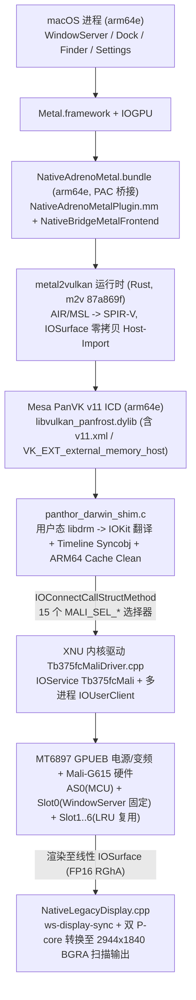

# MT6897 Mali-G615（Valhall CSF v11）在 macOS 27.3（UniXNU）上的完整 GPU 修复与 Bring-up 技术参考

> **适用对象**：在非 Apple ARM64 SoC（特别是联发科天玑 / ARM Mali Valhall CSF 架构 GPU）上移植 XNU / macOS / iPadOS 图形栈的开发者。
> **实机验证平台**：Lenovo Xiaoxin Pad Pro 12.7 (2025) / **TB375FC**
> - **SoC**：MT6897（天玑 8300，4×A510 + 4×A715，8 GB LPDDR5X）
> - **GPU**：ARM **Mali-G615 MC5**（`gpu_id=0xb8a31030`，`PAN_ARCH=11`，5 Shader Core `0x130011`，1 Tiler，8 AS，8 CSG，CSF MCU 固件 `v2.5 / 0x02050000`，非硬件缓存一致 `coherency=0x0`）
> - **目标系统**：macOS 27.3 (`26C5035r`) 完整桌面（`WindowServer`、`Dock`、`Finder`、`System Settings`、`MenuBarAgent` 等全部走真实硬件 GPU 进程内渲染，已实测连续运行 3.6+ 小时 / 38,000+ 帧 0 Panic）

---

## 一、整体架构：四层打通 macOS Metal → 硬件 Mali-G615

macOS 图形栈只认 **Metal / IOGPU / IOSurface**，而 Mali-G615 开源生态在 **Vulkan（Mesa PanVK）** 与 **Linux Panthor DRM** 上。我们在 XNU 上搭建了与上游 `UniXNU/AdrenoMetal` 同构的 **全进程内（In-Process）四层架构**：



### 为什么必须走「进程内直连」，而不是「单进程 GPU RPC Daemon」？

我们早期沿用 SwiftShader 时代的**单进程 Unix Socket RPC Daemon**（所有 App 通过 socket 把 Metal 命令发给一个 daemon，由 daemon 统一调 Vulkan），踩出了两个结构性死结：
1. **单点连坐黑屏**：所有 App 共用 1 个 `VkDevice` 和 1 个 Mali 地址空间，任意后台进程（如 `iconservicesagent`）触发一次内存导入报错或异常提交，就能直接拖垮 `WindowServer` 黑屏。
2. **串行化与跨进程拷贝瓶颈**：RPC 锁争用 + IOSurface 跨进程重复映射严重拉低帧率。

切换成 **进程内 `arm64e` Bundle（`NativeAdrenoMetal.bundle` 内嵌 `m2v` + `libvulkan_panfrost.dylib`）** 后：
- 每个 macOS 进程各自 `IOServiceOpen("Tb375fcMali")`，拥有**完全隔离的 GPU 48-bit 虚拟地址空间（`MaliVm`）**。
- `IOSurface` 本身就在本进程地址空间内，直接通过 `VK_EXT_external_memory_host` **原地零拷贝**交给 Mali MMU 映射。
- 后台进程崩溃或 GPU Fault 时内核仅驱逐该进程自己的 CSG 槽，**绝不影响 `WindowServer`**。

---

## 二、第 1 层：XNU 内核驱动（`Tb375fcMaliDriver.cpp`）

核心源码位于 `ram-expansion/kernel/mali-bringup/Tb375fcMaliDriver.cpp` 及共享 ABI `ram-expansion/mali-panvk/Tb375fcMaliABI.h`。

### 2.1 MT6897 GPUEB 上电与频率解锁（解决默认 26 MHz 龟速）

联发科平台不能直接访问 `0x13000000` 的 Mali 寄存器——GPU 电源域与 PLL 由独立的 **GPUEB 协处理器** 托管。必须按以下顺序握手：

1. **映射 4 个平台 MMIO 区域**：
   - `MFG_RPC = 0x13F90000`
   - `GPUEB_GPR = 0x13C2F000`（`GPR_BASE_OFF = 0xD1C`，`MBOX0_BASE_OFF = 0xD80`）
   - `GPUEB_MBOX = 0x13C62000`（Mailbox IRQ 控制寄存器）
   - `GPUEB_DRAM = 0x7FE70000`（16 KiB 共享通信内存）
2. **唤醒 GHPM**：若 `GPR_LP_STATE != 1` 或 `GPR_IPI_MAGIC == 0`，操作 `MFG_RPC + 0x800` 触发 `ENABLE` + `ON_SEQ` 上电序列，轮询直到 `GPR_IPI_MAGIC != 0`。
3. **初始化共享内存并给 GPU 上电**：清空 `GPUEB_DRAM`，经 `MBOX_CH_GPUFREQ (ch=1)` 发送：
   - `CMD_INIT_SHARED_MEM (0)` → 校验共享内存 `magic == 0xBABADADA`。
   - `CMD_POWER_CONTROL (6, power_state=1)` → 校验 `GF_REG_POWER_COUNT > 0`。
4. **解锁 GPU 频率（关键！）**：仅上电后 GPU 停留在 26 MHz 初始档，渲染一帧要几百毫秒。必须再发送：
   - `CMD_GET_FREQ_BY_IDX (1)` 遍历 OPP 表（MT6897 `table[0]=1400000 kHz`，`mid=884000 kHz`，`end=265000 kHz`）。
   - **`CMD_ACTIVE_SLEEP_CONTROL (7, state=1)`**（退出睡眠态，否则 `CMD_COMMIT` 不会真正升频！）。
   - **`CMD_COMMIT (8, target=0, idx=12)`** → 将 GPU 锁定在 `1206 MHz`（后续也可切 `idx=0` 到 `1400 MHz`），性能直接暴涨 **46×**。
5. **顺手解锁 CPU 频率**：通过 `mediatek,cpufreq-hw`（CSRAM `0x0011B000` 偏移 `0xC10/0xD30/0xE50`）将三个 CPU 簇拉满到 `2.0 / 2.8 / 3.0 GHz`，避免 CPU 侧 Metal→Vulkan 编码成为瓶颈。

### 2.2 Mali-G615 硬件复位与 CSF MCU 固件引导

Mali Valhall CSF（Arch 10+）不再用旧的 Job Manager（JM）寄存器提交任务，而是由片内 **MCU（ARM Cortex-M 核）** 跑固件 `mali_csffw.bin` 调度命令流：

1. **软复位与 L2 上电**：
   - 映射 `0x13000000`（大小 `2 MiB`，覆盖 Control + MMU + MCU + Doorbells 0..23）。
   - 写 `GPU_CMD_SOFT_RESET (0x0101)` 等 `GPU_IRQ_RESET_DONE`，写 `GPU_COHERENCY_PROT = 31`，写 `L2_PWRON_LO = 1` 等 `L2_READY_LO & 1`。
   - 读取硬件寄存器填充 `Tb375fcMaliDevInfo`（`gpu_id=0xb8a31030`, `shader_present=0x130011`, `tiler_present=0x1`, `as_present=0xff`）。
2. **加载 `mali_csffw.bin` 并建立 AS0 页表**：
   - 内核通过 VFS（`vnode_lookup` + `vn_rdwr`）读取 `/private/var/ngpu/mali_csffw.bin`（直接取自该机型原厂固件 / Linux `linux-firmware` 对应 Valhall CSF v2.5 固件）。
   - 分配 4 MiB `csfArenaDesc`（不带 `kIOMemoryKernelUserShared`，避免占用小内存池），解析固件头部 magic `0xC3F13A6E` 的所有 `etype == 0` 段，写入 4 级 ARM64 LPAE S1 页表并映射到 `AS0`（固定共享接口在 `0x04000000`，动态区 `0x04080000..0x04400000` 共 3.5 MiB 供各 CSG 分配 `suspend_buf` 与 `ringIo`）。
   - **【大坑 1】`AS_MEMATTR` 必须设为 `0x4C4C4C4C4C4C8F4C`**：
     Valhall MMU 的 `AS_MEMATTR` 编码不同于标准 ARMv8 CPU MAIR！如果按直觉填 `0xFF`，GPU 会出现 2.2 秒 Fence Timeout。合法的 Inner Write-Back Read/Write-Allocate 属性码是 **`0x8F`**（`AARCH64_INNER_ALLOC_IMPL`），Uncached 槽为 `0x4C`，`AS_TRANSCFG = 6 | (7 << 6) | (1 << 24)`。
   - **全量刷 Cache 后启动 MCU**：因为 MT6897 GPU 非硬件缓存一致（`coherency=0`），所有写入 `csfArenaVa` 的固件代码与页表项都必须 `dc civac` + `dsb sy`，再写 `MCU_CONTROL = MCU_CONTROL_AUTO (2)`，等待 `JOB_INT_RAWSTAT & JOB_INT_GLOBAL_IF`。
3. **全局接口配置（`GLB_CFG_ALLOC_EN`）**：
   - 读出 `FwGlobalControl`（`csgCount=8`, `csCount=8`, `cs_reg_count=96`, `scoreboard_slot_count=8`, `suspend_size`）。
   - 写 `glbIn->core_en_mask = shader_present`、设置 `progress_timer / poweroff_timer / idle_timer`（开 `GLB_IDLE_EN` 让空闲 CSG 主动让出硬件端点），置位 `GLB_CFG_ALLOC_EN` 并敲全局门铃 `CSF_DOORBELL(0)`，等 `glbOut->ack` 翻转。

### 2.3 多进程 7 硬件槽位 LRU 调度（Slot 0 固定 WindowServer + Slots 1..6 真正 Suspend/Resume）

Mali-G615 只有 **8 个 MMU Address Space（AS0..AS7）**：`AS0` 被 MCU 永久占用，用户进程只剩 **7 个硬件槽位**（Slot `k` 绑定 `AS(k+1)` + `CSG(k)` + `Doorbell(k+1)`）。而 macOS 桌面开机轻松跑 15–30 个使用 Metal 的进程！

我们的解耦设计：
- **软件对象与硬件槽分离**：每个 `Tb375fcMaliUserClient` 可创建最多 16 个 `MaliVm` 和 16 个 `MaliGroupEntry`，平时 `hw_slot = -1`，只在真正 `MALI_SEL_GROUP_SUBMIT` 时调 `ensureGroupResidentLocked()` 抢占硬件槽。
- **Slot 0 永久钉死给 `WindowServer`**：开机创建时直接驻留，永不驱逐，确保合成器每次提交零切换开销。
- **Slots 1..6 供其他进程按 LRU 复用**：
  - 选牺牲槽时**优先选已经空闲（`extract >= insert`）且最久未用的非 WS 槽**，其次才选最老的忙碌槽（先等其最多 1.5s 排空在途包）。
  - **【大坑 2】LRU 驱逐必须走 `CSG_STATE_SUSPEND` + 独立 `suspend_buf` / `ringIo` 页，绝不能 `TERMINATE`！**
    PanVK 在初始化队列时会在 CSF 的 96 个寄存器里写入持久化状态（如 `cs_subqueue_ctx_reg`）。如果驱逐时发 `CSG_STATE_TERMINATE`，下次重新 `START` 寄存器全丢，用户态下一帧提交立刻 GPU Fault 或死锁！
    正确做法：每个 `MaliGroupEntry` 在 `GROUP_CREATE` 时就在 AS0 动态池中分配**属于自己的** `suspend_buf` 和 `ringIoIn/Out` 页；驱逐时发 `CSG_STATE_SUSPEND` 把硬件寄存器/环指针完整存进 `suspend_buf`，下一次提交再发 `CSG_STATE_RESUME` 无缝恢复！
  - **【大坑 3】`max_tiler_cores` 必须钳位为 `1`，且统一 `grpPrio = 1`**：Mali-G615 只有 1 个 Tiler，不能按 Shader 核数去请求 5 个 Tiler；所有 CSG 设相同优先级 `1` 可防止 MCU 把全部端点锁死在单个进程里饿死其他进程。
- **锁顺序铁律**：全驱动严格遵守 `gMali.schedLock` → `client->fLock` → `gMali.lock` 单向加锁，杜绝死锁；客户端关闭/崩溃（`free()`）时必须**先驱逐并 `TERMINATE` 掉它占用的硬件槽**，再释放页表、Ring 和 BO。

### 2.4 用户态 4 级 LPAE 页表、BO 内存池与 XNU `kmem` 扩容

这是在 XNU 上跑真 GPU 踩得最惨的一块，直接决定了系统是 10 分钟 Panic 还是稳跑数小时：

1. **按需 128 KiB 页表 Chunk**：每个 `MaliVm` 不再预分配 16 MiB 页表，而是按需以 32 页（128 KiB）为单位分配普通内核页（不带 `kIOMemoryKernelUserShared`），并把 GPU VA `0` 映射到一个安全只读/空页防空指针 MMU Fault。
2. **三层 BO 分配策略（兼顾性能与防 `kmem_io` 耗尽）**：
   - **高频小 BO（≤16 MiB for WS / ≤1 MiB for 非 WS，且全局总量 ≤64 MiB）**：使用 `IOBufferMemoryDescriptor::withOptions(kIOMemoryKernelUserShared | kIODirectionInOut | kIOMapWriteCombineCache)`。硬件 **Write-Combine** 映射免去了每次提交前 CPU 对命令缓冲区/描述符做 `dc cvac`，WindowServer 提交耗时从 `~450 µs` 骤降到 `~5–50 µs`。
   - **只给 GPU 用的 `NO_MMAP` BO（Private 纹理/Tiler Heap）**：使用 `IOBufferMemoryDescriptor::inTaskWithOptions(fTask, kIODirectionInOut | kIOMemoryPageable)`，**零消耗 `kmem_io`**；创建后短暂映射清零并 `dc civac` 刷回 DRAM。
   - **超出 WC 预算的大 Mappable BO**：返回 `kIOReturnNoMemory` 通知用户态 shim 走 `mmap(MAP_ANON)` + `MALI_SEL_BO_IMPORT_HOST`（单份 Normal-WB 映射，**严禁在 ARM64 上把同一物理页同时映射成 WB 和 NC/WC，否则会触发 Cache Aliasing 数据花屏/损坏！**）。
3. **Host 内存 / IOSurface 零拷贝导入（含只读页兜底）**：
   - `MALI_SEL_BO_IMPORT_HOST` 先尝试 `IOMemoryDescriptor::withAddressRange(host_ptr, sz, kIODirectionInOut, fTask)`；若该页是只读映射（如 macOS 系统字体/图标共享缓冲），`prepare()` 会失败，立即**降级为 `kIODirectionOut`**（CPU 只读、GPU 可读）成功 wire 物理页，彻底修复 `ERROR_INVALID_EXTERNAL_HANDLE` 导致的 `iconservicesagent` 崩溃。
4. **【大坑 4】XNU 内核 VA 池被 `compressor` 吃干导致 `kmem_alloc` Panic**：
   - 在 8 GB 内存的 macOS 27 上，XNU 默认给内存压缩子图（`compressor` submap）划走 **11 GiB** 内核 VA，把剩余所有 4 个 `kmem` 池挤到总共仅剩 `1.7 GiB`（其中 `DATA_SHARED` 默认仅 `128 MiB`，`kmem_ptr_range_0` 也常被挤到 `268 MiB`）。一旦多进程打开 Metal + APFS 压缩解包（`decmpfs`），立刻触发 `ubc_upl_map kr=0x3` 甚至数百万次 `kmem_alloc` 失败而 Panic。
   - **根治方案**：
     1. 启动参数加入 Apple 原生 tunable：**`vm_compression_limit=524288`**（把压缩池上限设为 2 GiB，释放出 ~5.4 GiB 内核 VA）。
     2. 在 `ram-expansion/kernel/vm_kern.c` 中把 `kmem_io` 设为 **`512 MiB`**，同时保持其余三个主池均衡 1/3 切分。
     3. 实测结果：`kmem_ptr_range_0`、`kmem_data_shared_range`、`kmem_data_private_range` 各自扩容到 **`~2.1 GiB`**，3.6+ 小时运行 `kmem_alloc` 失败次数为 **`0`**！

### 2.5 CSF 命令提交、Cache 维护与沙盒放行

- **命令提交（`MALI_SEL_GROUP_SUBMIT`）**：
  因为是非硬件缓存一致 SoC，每次向 Ring 写命令包时，首包前插 `FLUSH_CACHES(0x233)`（刷新 L2 + LSC），随后 `CALL` PanVK 的命令流 + `WAIT(waitAll)`，尾包后再插一次 `FLUSH_CACHES(0x233)` 把 GPU 渲染结果刷回 DRAM，确保 CPU 或 `NativeLegacyDisplay` 能立刻读到完整像素；最后整批只敲**一次** `CSF_DOORBELL(dbId)`。
- **沙盒放行**：
  给 `Tb375fcMali` 设置属性 `NativeSandboxGrantAll = true`，并在 XNU `IOUserClient.cpp` 的 `native_sandbox_grant()` 中检查该属性直接返回允许，让所有处于 App Sandbox / Seatbelt 内的系统与第三方进程都能打开 Mali 驱动。
- **调试通道 `MALI_SEL_DEBUG_LOG (sel=14)`**：
  沙盒进程往往不能写 `/dev/console` 或文件，暴露一个 192 字节字符串的 IOKit Selector 让用户态直接把日志打进内核 `IOLog`（通过 USB CDC 串口实时可见），排错效率提升十倍。

---

## 三、第 2 层：Mesa PanVK 移植到 Darwin + Mali-G615 (`PAN_ARCH=11`)

基于 Mesa 上游提交 `85fda3b`，整个移植**仅改动 28 个文件（+285/-26 行）**外加 `v11.xml` 和一个独立的 Darwin 适配层 `panthor_darwin_shim.c`。

### 3.1 解锁 Mali-G615 (`PAN_ARCH=11`) 支持

- `src/panfrost/model/pan_model.c`：注册 G615 型号表项：
  ```c
  VALHALL_MODEL(PAN_PROD_ID(11, 8, 3), 0, "G615", "TTUx",
                MODEL_ANISO(ALL), MODEL_TB_SIZES(32768, 16384),
                MODEL_RATES(4, 8, 64)),
  ```
- `src/panfrost/genxml/v11.xml`：基于 `v10.xml` 生成 `arch="11"` 硬件描述符 XML，并在 `genxml/meson.build`、`gen_macros.h`、`decode.h`、`lib/meson.build`、`libpan/meson.build`、`panvk_macros.h` 中打开 `PAN_ARCH=11` 分发编译。

### 3.2 `panthor_darwin_shim.c`：用 ~1460 行 C 伪装完整 Linux Panthor DRM

不侵入 Mesa PanVK 内部，直接实现 `xf86drm.h` 声明的 `drmIoctl()`、`drmGetDevices2()`、`drmGetVersion()`（返回 `"panthor" 1.7.0`）以及全套 **Timeline Syncobj** 引擎：

- **IOCTL 映射**：将 `DRM_IOCTL_PANTHOR_DEV_QUERY`、`VM_CREATE/BIND`、`BO_CREATE/MMAP_OFFSET/GEM_CLOSE`、`TILER_HEAP_CREATE`、`GROUP_CREATE/SUBMIT/GET_STATE` 逐一翻译为 `IOConnectCallStructMethod(conn, MALI_SEL_*, ...)`。
- **Timeline Syncobj 引擎**：
  - 在用户态用 `pthread_mutex` + `pthread_cond` 维护 `signaled_point` 与待完成 `(group, fence_seq)` 列表。
  - 完整支持 `WAIT_ALL`、`WAIT_ANY`、`WAIT_FOR_SUBMIT`（wait-before-signal）、`WAIT_AVAILABLE` 以及 `drmSyncobjTransfer`（包括自转移与二值覆盖语义）。
  - **关键点**：`DRM_IOCTL_PANTHOR_VM_BIND` 在执行 `UNMAP` 之前必须先等待所有输入 syncobj 完成，否则会提前撤销仍在执行的 GPU 帧的页表导致 MMU Fault！
- **增量 Cache Clean 策略**：
  - 提交前 `flush_all_host_bos()` 仅刷两类内存：① `< 2 MiB` 的 host BO（跳过 `>= 2 MiB` 的大型 IOSurface 渲染目标，避免每帧无意义刷几十 MB）；② 真正被 CPU `mmap` 且标记为 `g_mmap_cached` 的 Normal-WB BO（未 mmap 的 Private 纹理和内核 WC 映射 BO 跳过，0 开销）。

### 3.3 实现 `VK_EXT_external_memory_host`（macOS IOSurface 零拷贝基石）

- `panvk_vX_physical_device.c`：在 `__APPLE__` 下开启 `.EXT_external_memory_host = true`，设置 `.minImportedHostPointerAlignment = 4096`。
- `panvk_physical_device.c`：在外部缓冲区/图像属性查询中对 `HOST_ALLOCATION_BIT_EXT` 和 `HOST_MAPPED_FOREIGN_MEMORY_BIT_EXT` 返回 `IMPORTABLE_BIT`。
- `panvk_device_memory.c` + `pan_kmod.c`：
  - `panvk_AllocateMemory` 识别 `VkImportMemoryHostPointerInfoEXT`，调用 `pan_kmod_bo_import_host()` → `panthor_darwin_import_host_handle()` → `MALI_SEL_BO_IMPORT_HOST`。
  - `panvk_MapMemory2KHR` 对导入的 host 内存直接返回原始 `imported_host_ptr + offset`，`Unmap` / `FreeMemory` 不重复 `munmap`。
  - 实现 `panvk_GetMemoryHostPointerPropertiesEXT`。

### 3.4 Darwin 上踩出的 4 个必杀级 Mesa Bug 修复

| 编号 | 文件 | 现象 | 根因与修法 |
| --- | --- | --- | --- |
| **M1** | `src/util/cache_ops_aarch64.c` | PanVK 一刷缓存就 `SIGILL` 崩溃 | macOS / Darwin 禁止 EL0 用户态执行 `mrs ctr_el0`。在 `#if defined(__APPLE__)` 下直接返回 MT6897 的 64 字节缓存行编码 `(4u << 24) | (4u << 16)`。 |
| **M2** | `src/panfrost/compiler/bifrost/bi_ra.c` | 编译 macOS CoreAnimation 超大 Shader 时内存飙升 **1+ GiB**、卡死 **3+ 分钟** | Bifrost 寄存器分配器 `nodearray_orr()` 在 256 个元素时就切到稠密数组，单数组 >32 KiB 反复触发 macOS `xzone` 大块分配 `madvise` 锁竞争。**三连修**：① 稠密阈值 `256 → 2048`（稀疏上限 16 KiB，避开 32 KiB 阈值）；② `bi_mark_interference` 每 8 字节 `uint64_t` 跳过全 0 活跃区；③ SSA 寄存器需求 `>32` 时直接跳过必败的 32-reg 压榨轮次。编译耗时瞬间从分钟级降到 **4–9 ms**！ |
| **M3** | `src/panfrost/vulkan/panvk_vX_device.c` | 进程内创建逻辑 `VkDevice` 失败或共享错 fd | Linux 下用 `os_dupfd_cloexec()` 复制 DRM fd；Darwin 下改为重新调 `panthor_darwin_open_render_node()` 建立独立的 IOKit 连接。 |
| **M4** | `src/vulkan/runtime/vk_image.c` | macOS 上编译/运行缺失 `drm_format_mod` | 把 `#if DETECT_OS_LINUX \|\| DETECT_OS_BSD` 扩展为包含 `DETECT_OS_APPLE`，启用 `drm_fourcc.h` 与 `DRM_FORMAT_MOD_INVALID`。 |

### 3.5 `arm64e` 交叉编译要点（`build_panvk_darwin.py`）

- 先在宿主机 Mac 编译一套原生工具链（`mesa_clc`、`vtn_bindgen2`、`panfrost_compile`）放到 `PATH`。
- 用 Meson cross-file 指定 `-target arm64e-apple-macos15.0 -fstack-protector-strong -DPANTHOR_DARWIN=1`，配置：
  ```
  -Dgallium-drivers= -Dvulkan-drivers=panfrost -Dplatforms=macos
  -Dmesa-clc=system -Dprecomp-compiler=system -Dopengl=false
  -Dglx=disabled -Degl=disabled -Dgbm=disabled -Dllvm=disabled
  -Dshader-cache=enabled -Dbuildtype=release -Db_ndebug=true
  ```
- 产出 `libvulkan_panfrost.dylib` 后必须执行 `macho-self-bind-weak-imports.py`（修弱符号绑定）并用 `--pagesize 4096` 做 ad-hoc 签名，把 CDHash 写进 `kernel.macho.trustcache`。

---

## 四、第 3 层：Metal → Vulkan 运行时与 `arm64e` 进程内插件

基于 `UniXNU/metal2vulkan`（`87a869f`，上游 `steelbrain/metal2vulkan 0c9db497` + UniXNU 零拷贝原地 Linear Host-Import 补丁）与 `UniXNU/AdrenoMetal`。

### 4.1 `metal2vulkan`（Rust）针对 PanVK v11 的 4 处极简改动

1. **`crates/metal2vulkan-runtime/src/floor.rs`**：PanVK Valhall v11 尚未报告 7 个高级 Vulkan 特性（`robust_image_access2`、`shader_clip_distance`、`tessellation_shader`、`shader_tessellation_and_geometry_point_size`、`shader_output_layer`、`multi_viewport`、`shader_output_viewport_index`、`vertex_pipeline_stores_and_atomics`），但 macOS 桌面（QuartzCore / CoreAnimation / AppKit / SwiftUI）基本用不到它们。将这 7 项从 `REQUIRED` 移到 `OPTIONAL`（驱动支持就开、不支持也不拒启）。
2. **`memory.rs` / `ring.rs` / `staging.rs`**：因为切成了**多进程内架构**（几十个进程各自起一个 `m2v` 实例），默认每个进程 `16 MiB` 的主分配块 + `16 MiB` staging + `2 MiB` ring 会迅速耗尽 8 GB RAM。分别收紧为 **`2 MiB` / `2 MiB` / `512 KiB`**，多进程内存占用骤降 ~8 倍。

### 4.2 Metal 前端补丁（`NativeBridgeMetalFrontend_patched.mm` & `NativeAdrenoMetalPlugin.mm`）

1. **`MTLStorageModeMemoryless → Private` 无条件降级**：
   macOS 27 的 `RenderBox`、`iconservicesagent`、`ControlCenter` 会大量创建 1x MSAA（`samples == 1`）的 Memoryless 渲染附件，而 `m2v v2` 明确拒绝 `StorageMode::Memoryless`（`Gap::MemorylessTexture`），此前引发每秒 4,000 次纹理创建失败风暴。在前端和 `bridge-v2/src/NativeMetalTexture.rs` 两处统一映射为 `Private` 后彻底归零。
2. **`newLibraryWithFile:` 1 MiB 分块 `pread()` 兜底**：
   macOS 系统 `.metallib` 大多带 APFS 透明压缩（`decmpfs`），偶发 `NSDataReadingMappedIfSafe` 触发 `ubc_upl_map kr=0x3` 导致整个 App 的着色器库加载失败。增加 `open` + 1 MiB 循环 `pread` 回退后 100% 稳定加载。
3. **关键环境变量（缺一不可！）**：
   ```c
   setenv("PANVK_DEBUG", "noafbc", 0);                 // 禁用 AFBC，但保留内部 16x16 Tiled！(不要加 linear！)
   setenv("CA_DISABLE_FRAMEBUFFER_COMPRESSION", "1", 1);
   setenv("CA_DISPLAY_EDR_HEADROOM", "1", 1);          // 关闭 EDR 避免无意义 HDR 通道
   setenv("CA_FP16_MIN_HEADROOM", "1e30", 1);
   setenv("METAL2VULKAN_COMPILE_ON_ASKING_THREAD", "1", 1);
   ```
   - **【大坑 5】为什么只设 `noafbc` 而不能设 `noafbc,linear`？**
     `noafbc` 是必须的（CPU 显示扫描和跨进程 IOSurface 都不懂 Mali 专有 AFBC 压缩格式）。但一旦加上全局 `linear`，Mali 内部 25–30 个中间 RenderTarget 全部失去 16×16 Tile 局部性，单帧 `fence wait` 暴涨到 11–14+ ms。配合 `m2v 87a869f` 的 **原地 Linear Host-Import**，只有外部 `IOSurface` 走 `VK_IMAGE_TILING_LINEAR`，内部 RenderTarget 全部走硬件最优 Tiled！
4. **沙盒友好型 Shader 磁盘缓存**：
   用 `sandbox_check(pid, "file-write-create", ...)` 静默探测可写目录，按 `HOME/Library/Caches/org.unixnu.metal` → `pw_dir` → `_CS_DARWIN_USER_CACHE_DIR/com.apple.metal/m2v` → `_CS_DARWIN_USER_TEMP_DIR/m2v` → `/private/var/tmp/tb375fc-m2v-<uid>` 逐级回退，全不可写时自动启用 `METAL2VULKAN_SHADER_CACHE_OPTIONAL=1` 内存模式，**零沙盒拒绝刷屏、零启动崩溃**。
5. **Rust 静态库 ↔ macOS `arm64e` PAC 桥接（`build_inproc_bundle.py`）**：
   macOS 系统进程全部强制 `arm64e`（指针认证 PAC），而 Rust 编译器默认生成普通 `arm64` 间接调用（未签名函数指针直接触发 PAC 异常崩溃）。解决方案完全复刻上游 `UniXNU`：
   - 用 `llvm-objcopy --redefine-sym` 把 `libadreno_metal_bridge.a` 中接收函数指针的 7 个 C 符号（`_pthread_create`, `__tlv_atexit`, `_atexit`, `___cxa_atexit`, `__dyld_register_func_for_add_image`, `__Unwind_Backtrace`, `_dlsym`）改名指向 `arm64e` 编译的 `RustPacBoundary.c` 签名包装器；
   - 链接生成 `NativeAdrenoMetal` 后带 `-Wl,-map` 运行 `rust-pac-rewrite.py`，把 Rust 目标段内所有间接 `blr/br` 指令重写成通过 `nmb_pac_call_x0..29` 的 PAC 跳板；
   - 最终将 `NativeAdrenoMetal.bundle`（内含 `libvulkan_panfrost.dylib`）统一做 4 KiB 签名并注册 CDHash 到内核 `trustcache`。

---

## 五、第 4 层：WindowServer 帧调度与显示同步（`NativeLegacyDisplay.cpp`）

1. **WindowServer 帧调度解锁**（`NativeAdrenoMetalPlugin.mm` constructor）：
   - 开启 `CA_FORCE_TRIPLE_BUFFERED_LATENCY`（允许超前渲染，避免 >1 刷新周期后锁死等待）。
   - Hook `CAWindowServerDisplay` 的 `nextWakeupTime` / `beginExternalUpdate:usingSoftwareRenderer:` 实现 `freeWakeup`（解除 SkyLight 16.7 ms 网格对齐惩罚）。
2. **显示推帧与 GPU 同步**（`NativeLegacyDisplay.cpp`）：
   - `WindowServer` 在有真 Metal 设备时输出 `RGhA`（64-bit FP16 RGBA）线性 IOSurface，由内核 `NativeLegacyDisplay` 用 **2 个 P-core 线程**并行执行 `flush_dcache64` + 2× 放大转换为 `2944×1840 BGRA` 写入 GOP 扫描帧缓冲（带脏行哈希跳过未变行 + 奇偶行锁步扫描消除中线撕裂）。
   - **GPU-Display 同步**：因为 `WindowServer` 在 Metal `didSchedule`（GPU 刚提交、尚未画完）时就触发 `IOMobileFramebufferSwapEnd`，如果显示驱动直接读 IOSurface 会把画到一半的帧刷到屏幕上（肉眼表现为画面闪烁/部分图层缺失）。内核导出 `tb375fc_mali_wait_ws_idle()`，在读取 IOSurface 前轮询 `WindowServer` 固定槽位 `CSG0` 的 `ringIoOutCpu[q]->extract >= target`，确保 Mali 已画完并冲刷 L2+LSC 到 DRAM 后再读。

---

## 六、血泪踩坑速查表（Top 12，移植避坑必看）

| # | 现象 / 报错 | 真实根因 | 一句话修法 |
| --- | --- | --- | --- |
| 1 | GPU 读 `GPU_ID` 卡死或渲染 1 帧要 500 ms | 联发科 GPU 未走 GPUEB 上电，或上电后停在 26 MHz 初始频率 | 走 `MFG_RPC` + `GPUEB MBOX` 发送 `POWER_CONTROL(1)` + `ACTIVE_SLEEP_CONTROL(1)` + `CMD_COMMIT` 升频至 1206–1400 MHz |
| 2 | 提交任何 Shader 都报 2.2s Fence Timeout | `AS_MEMATTR` 按标准 ARM MAIR 填了 `0xFF`，Valhall 硬件不认 | 改为 Valhall 合法编码 **`0x8F`**（`0x4C4C4C4C4C4C8F4C`） |
| 3 | 多进程切换后后台 App 立刻 CS Fault / 死锁 | 超过 7 个进程时 LRU 驱逐发了 `CSG_STATE_TERMINATE`，清空了 96 个 CSF 寄存器 | 为每个 Group 分配独立 AS0 `suspend_buf` 和 `ringIo`，驱逐用 `CSG_STATE_SUSPEND`，恢复用 `CSG_STATE_RESUME` |
| 4 | 多个进程同时跑时界面卡死或某个 App 永远拿不到 GPU | `max_tiler_cores` 填了 5（G615 只有 1 个 Tiler）或优先级不均 | `maxT = 1`、`grpPrio = 1`、全局开启 `GLB_IDLE_EN` |
| 5 | 跑半小时到一小时随机内核 Panic（`kmem_alloc` 失败） | XNU `compressor` 吃走 11 GiB 内核 VA，挤压 `DATA_SHARED` / `ptr_range_0` | 加启动参数 `vm_compression_limit=524288` + `vm_kern.c` 设 `kmem_io = 512 MiB` 并均衡切分三池 |
| 6 | PanVK 一启动立刻 `SIGILL` | `cache_ops_aarch64.c` 在用户态执行了 `mrs ctr_el0` | `#ifdef __APPLE__` 返回硬编码 `(4u << 24) | (4u << 16)` |
| 7 | 桌面启动卡死 3 分钟且内存暴涨 1+ GiB | Bifrost RA 的 `nodearray_orr` 阈值 256 踩中 macOS `xzone` 32 KiB 大分配 `madvise` 陷阱 | `bi_ra.c` 阈值改 `2048` + 8 字节跳零 + `demand > 32` 跳过 32-reg 压榨轮 |
| 8 | `iconservicesagent` 崩溃报 `ERROR_INVALID_EXTERNAL_HANDLE` | 只读 host 内存用 `kIODirectionInOut` wire 失败 | `MALI_SEL_BO_IMPORT_HOST` 失败自动降级 `kIODirectionOut` |
| 9 | 画面随机出现块状花屏 / 脏像素 | ARM64 同一物理页同时存在 Normal-WB 和 WC/NC 双映射（Cache Aliasing），或 GPU 未刷 L2/LSC | 大 BO 只留单份 `MAP_ANON` WB 映射；CSF Ring 首尾加 `FLUSH_CACHES(0x233)`；显示读取前 `flush_dcache64` |
| 10 | `RenderBox` / `ControlCenter` 每秒刷屏 4000 次纹理创建失败 | macOS 27 创建大量 1x `MTLStorageModeMemoryless` 附件，m2v v2 拒绝 | Frontend 与 `NativeMetalTexture.rs` 无条件把 Memoryless 降级为 Private |
| 11 | `arm64e` 系统进程加载 Rust m2v 直接 PAC 崩溃 | Rust 编译产物未签函数指针，跨 C 回调/间接跳转失败 | `llvm-objcopy` 重定向回调符号至 `RustPacBoundary.c` + `rust-pac-rewrite.py` 重写间接跳转 |
| 12 | 画面中间偶尔闪烁，或部分最后绘制图层消失 | `WindowServer` 在 `didSchedule` 就提交 Swap，显示驱动在 Mali 未画完时就读取了 IOSurface | 显示驱动读取前调用 `tb375fc_mali_wait_ws_idle()` 等待 `CSG0` 完成，并确保超时阈值足够覆盖重负载帧 |

---

## 七、关键源码文件清单与构建顺序

### 关键源码位置（均位于 `local-artifacts/macos27-firstboot/ram-expansion/` 下）
- **内核 Mali 驱动**：`kernel/mali-bringup/Tb375fcMaliDriver.cpp` + `mali-panvk/Tb375fcMaliABI.h`
- **内核 VA 池调优**：`kernel/vm_kern.c`（配合 boot-arg `vm_compression_limit=524288`）
- **内核显示与 GPU 同步**：`kernel/NativeLegacyDisplay.cpp`
- **Mesa PanVK Darwin 适配与补丁**：`mali-panvk/darwin-drm/panthor_darwin_shim.c` + `mali-panvk/mesa-src`（含 `v11.xml` 及上述 28 个文件补丁）+ `mali-panvk/build_panvk_darwin.py`
- **Metal→Vulkan 运行时**：`gpu-diag/m2v-v2-src` + `gpu-diag/bridge-v2`
- **进程内 `arm64e` Metal 插件打包**：`gpu-plugin/NativeAdrenoMetalPlugin.mm` + `gpu-plugin/NativeBridgeMetalFrontend_patched.mm` + `gpu-plugin/build_inproc_bundle.py`
- **整机内核 + 插件 + Trustcache 打包**：`desktop/build_desktop_tier3.py`

### 端到端构建顺序
1. 编译内核 Mali 驱动静态库：`build_mali_driver.py` → `libTb375fcTouch_mali4.a`。
2. 交叉编译 `arm64e` Mesa PanVK：`build_panvk_darwin.py --arm64e` → `libvulkan_panfrost.dylib`（改过 `darwin-drm/panthor_darwin_shim.c` 需先同步进 `mesa-src/src/panfrost/vulkan/darwin_shim/`）。
3. 编译 Rust `bridge-v2`（`arm64e-apple-darwin` release）→ `libadreno_metal_bridge.a`。
4. 构建并 PAC 重写 + 4K 签名进程内插件：`build_inproc_bundle.py` → `NativeAdrenoMetal.bundle`。
5. 打包内核、插件、固件（`mali_csffw.bin`）与更新后的 `trustcache`：`build_desktop_tier3.py --mali-driver --inproc-bundle ... --extra-boot-arg "mali=4" --extra-boot-arg "vm_compression_limit=524288"`。

---

## 八、当前已知优化空间（供参考 / 下一步调优方向）

截至目前（Boot 148），真实硬件 GPU 渲染、多进程隔离、触控灵敏度和数小时零 Panic 稳定性都已验证通过；接下来主要在攻关两项**性能优化**：
1. **拉升满载滚动帧率（从 ~30 fps 向 50–60+ fps 推进）**：
   - GPU OPP 从 `1206 MHz (idx=12)` 提至满血 **`1400 MHz (idx=0)`**；
   - 将 `NativeLegacyDisplay` 的全像素脏行哈希改为 **ARM64 NEON 128-bit 向量化**（把 `flush+conv` 从 `4–6 ms` 压回 `1–1.8 ms`）；
   - 排查并优化 `ws-display-sync` 与三重缓冲下帧 `N` / 帧 `N+1` 的精确围栏对应，以及减少每帧冗余的 CPU Cache Flush 和 CSF 子包间过度 `WAIT(waitAll)` 串行化。
2. **杜绝重负载滚动时偶发半截 Dock / 灵动岛闪隐**：
   - 当重负载模糊帧超过当前 `25 ms` 的显示等待超时后，显示驱动提前把未画完最后两个叠加层（Dock 与 MenuBarAgent 灵动岛）的 IOSurface 刷上了屏；通过降低单帧耗时 + 提高等待保护阈值（绝不刷半成品帧）即可彻底消除。

---

## 九、同机型（TB375FC / MT6897）直接复现与对照清单

既然你朋友也是 **同款 TB375FC（小新 Pad Pro 12.7 2025 / MT6897）**，以下参数、地址、固件校验值和最小补丁全部**实机验证过，可直接照抄**，省去从头逆向 DTB 和猜寄存器的时间：

### 9.1 TB375FC 精确硬件地址与期待值表

| 模块 | 物理基址 | 映射大小 / 关键偏移 | TB375FC 实测校验值 |
| --- | --- | --- | --- |
| **Mali-G615 主寄存器** | `0x13000000` | `0x200000` (2 MiB，含 Doorbell 0..23) | `GPU_ID = 0xb8a31030`、`SHADER = 0x130011` (5 核)、`TILER = 0x1`、`AS = 0xff` |
| **MFG_RPC (GHPM 上电)** | `0x13F90000` | `0x1000` (`GHPM_CFG0_CON = +0x800`) | bit0=`ENABLE`, bit2=`ON_SEQ` |
| **GPUEB GPR / MBOX0** | `0x13C2F000` | `0x1000` (`GPR=+0xD1C`, `MBOX0=+0xD80`) | `GPR+0x28` (`LP_STATE=1`), `GPR+0x34` (`IPI_MAGIC!=0`), `TX=+0x10`, `RX=+0xE8` |
| **GPUEB MBOX IRQ** | `0x13C62000` | `0x1000` (`TX_STS=+0x0`, `IRQ_SET=+0x4`, `IRQ_CLR=+0x74`, `RX_STS=+0x78`) | 通道 bit = `1 << 1` (`MBOX_CH_GPUFREQ`) |
| **GPUEB 共享 DRAM** | `0x7FE70000` | `0x4000` (16 KiB) | `MAGIC (+0x00) = 0xBABADADA`, `OPP_NUM (+0x0C)`, `PWR_CNT (+0x1C)`, `CUR_FREQ (+0x44)` |
| **CPUHW 变频 CSRAM** | `0x0011B000` | `0x2000` (`dom0=+0xC10`, `dom1=+0xD30`, `dom2=+0xE50`) | `+0x84` enable, `+0x88` OPP idx → `2000 / 2800 / 3000 MHz` |

### 9.2 `mali_csffw.bin` 固件提取与校验

- **来源**：直接从 TB375FC 原厂 Android 的 `/vendor/firmware/mali_csffw.bin` 提取（与 Linux `linux-firmware` 中对应 Valhall Arch 11 CSF 固件一致）。
- **放置位置**：打包进 `kernel.macho.gpuaddon` 根目录，运行时挂载在 `/private/var/ngpu/mali_csffw.bin` 供 XNU VFS 读取。
- **TB375FC 实测固件校验信息**：
  - 大小：`290,816` 字节
  - 头部 Magic：`0xC3F13A6E`（header version `0.3`；MCU 跑起后共享接口上报 `fw_iface_ver = 0x02050000`）
  - `sha256`：`4e41030636f730feef28e0dc00c98b9846beb5f98f0dc5836b616509f3d7d46c`

### 9.3 XNU 内核 3 处最小补丁（可直接照贴）

1. **放行沙盒内进程直连 `Tb375fcMali`（`iokit/Kernel/IOUserClient.cpp`）**：
   ```cpp
   native_sandbox_grant(IOService * service)
   {
       if (service->getProperty("NativeSandboxGrantAll") == kOSBooleanTrue) {
           return true;
       }
       OSString * list = OSDynamicCast(OSString, service->getProperty("NativeSandboxGrantProcess"));
       ...
   ```
2. **扩充 `kmem_io` 到 512 MiB（`osfmk/vm/vm_kern.c` 的 `kmem_add_extra_claims()`）**：
   ```c
   kmem_claims[kmem_claim_count++] = (struct kmem_range_startup_spec){
       .kc_name  = "kmem_io",
       .kc_range = kmem_range(KMEM_RANGE_ID_IO),
       .kc_size  = (512u << 20), /* 配合 boot-arg vm_compression_limit=524288，三主池各得 ~2.1 GiB */
       .kc_flags = KC_NO_ENTRY,
   };
   ```
3. **编译并链接 `Tb375fcMaliDriver.cpp`**：
   直接复用 XNU 构建目录 `iokit/DEVELOPMENT/IOPlatformExpert.cpo.json` 的编译参数（确保 `arm64e` ABI、头文件和 PAC 选项完全一致）编译成 `.o` 静态链接进内核，在平台初始化晚期调用 `tb375fc_mali_probe()`（启动参数带 `mali=4` 时启动后台内核线程上电并注册 `IOService("Tb375fcMali")`）。

### 9.4 TB375FC 实测通过的完整 Boot-Args

```text
mali=4 vm_compressor=2 vm_compression_limit=524288 aicr=2500 disp-hz=120 vsync=120 touch=4
```

- `mali=4`：开启完整 GPUEB 升频 + Mali-G615 MCU + 多进程 `Tb375fcMali` IOUserClient。
- `vm_compressor=2 vm_compression_limit=524288`：**必加！** 限制 XNU compressor submap 至 2 GiB，防止跑半小时后 `kmem_alloc` 耗尽 Panic。
- `aicr=2500`：MT6375 输入限流 2.5A（满血 CPU+GPU 依然保持净正充）。
- `disp-hz=120 vsync=120`：开启 120 Hz 显示刷新与 WindowServer VSync 节拍。
- 可选：`island-y=17.5`（灵动岛垂直居中对齐菜单栏图标，已在插件默认启用）。

### 9.5 串口 / `dmesg` 验收 checklist（看到以下 6 类日志即 100% 打通）

```text
1. Tb375fcMali: GPUEB CMD_COMMIT(tgt=0 idx=12) rc=0 ret=0 -> cur_gpu_freq=1206000 kHz
2. Tb375fcMali: GLB_CFG_ALLOC_EN ACK (... cs=8 regs=96 sb=8 ...)
3. Tb375fcMali: READY (multi-proc) gpu_id=0xb8a31030 shader=0x130011 coh=0x0 fw=0x02050000 csg=8 mcu=1
4. [mali-metal] WindowServer(...) OPEN OK reg=0x... cache=...
5. Tb375fcMali: CSG[0] STARTED proc=WindowServer as=1 q=... db=1 ep=0x...
6. Tb375fcMali: HW FENCE OK #1 proc=WindowServer csg=0 seq=... gpuFlt=0x0 asFlt=0x0
```

只要第 6 行的 `gpuFlt=0x0 asFlt=0x0` 出现、并且后续 `[mali-ws]` 心跳持续递增且无 `[mali-problem]` 刷屏，说明 TB375FC 的真实 Mali-G615 硬件加速就已经彻底跑通了！

> **源码参考**：所有开源改动（内核驱动、Mesa PanVK v11 补丁、`panthor_darwin_shim.c`、Metal 插件打包脚本，不含任何苹果固件或私有二进制）后续也会统一整理推送到 `https://github.com/liimagination/UniXNU-tb375fc` 的 `feat/mali-panvk-m2v2` 分支，可直接对照。
