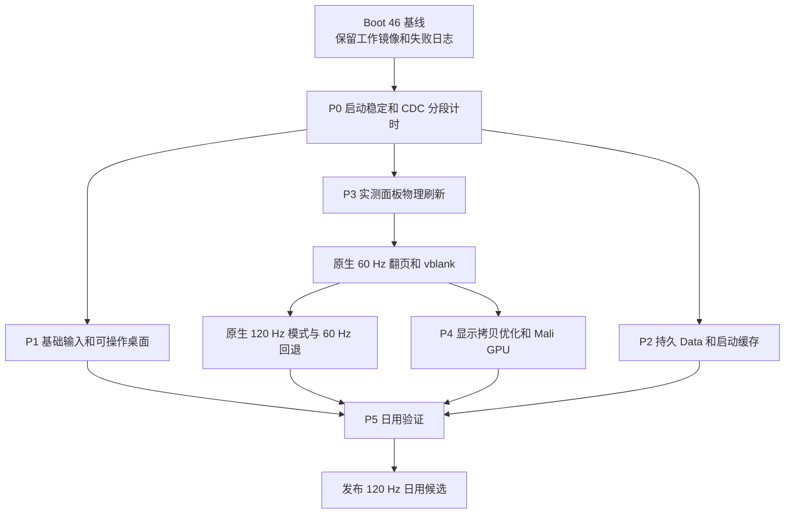

# TB375FC macOS 27.3 日用与 120 Hz 开发计划

2026 年 11 月 22 日 · 联想小新 Pad Pro 12.7 2025 · MT6897 · macOS 27.3（`26C5035r`）

**目标是把已经能点亮桌面的 Boot 46，推进到可稳定启动、可长时间操作、文件跨重启保留、内屏实测 120 Hz 的日用版本。** 推荐顺序是先稳住启动和输入，同时测真实显示节奏，再推进持久化 Data、原生显示和 GPU 加速。启动提速以开机到可操作桌面为准，120 Hz 以面板实际刷新和动画期间的独立呈现帧为准。

## 1. 起点与验收定义

| 项目 | 现有证据 | 日用交付要求 |
| --- | --- | --- |
| 启动 | Boot 46 成功实机从 UEFI 手动选择到出现光标用 6 分 21 秒，到壁纸用 10 分 08 秒。现场只留下短 CDC 片段。 | 开机后可登录、打开 Finder 和操作窗口。分阶段记录耗时，逐步争取中位数低于 3 分钟。 |
| 稳定性 | 重新采集时，相同启动配置在日志时间戳 108.729 秒发生内核 IB 返回地址认证失败，启动日志也记录到 0% 电量。 | 在电源条件已记录的情况下复测。成功进入壁纸的一次和后来 panic 的一次都保留。 |
| 内存和存储 | 有 8 GiB 物理内存，历史 `hw.memsize` 为 7,373,590,528 字节，约 6.87 GiB。Boot 46 的 Data seed 提供 1 GiB 逻辑容量，系统卷从只读 UFS 加载。 | 维护内核实际可用 RAM、Data 卷余量和应用内存压力三项指标，文件与设置使用持久 Data。 |
| 输入 | 已离线打包 `touch=1` 只读探测候选。触控控制器链路和 HID 事件待实机验证。 | 至少有一个可以长期使用的指针设备和文本输入路径，内屏触控覆盖旋转、点击、拖动和滚动。 |
| 显示 | Boot 46 实机确认桌面壁纸。当前显示路径通过固件 framebuffer 拷贝画面，`vsync=` 控制软件通知节奏。 | 物理 120 Hz 独立测量通过，合成连续帧和输入体验达标，60 Hz 模式可用作回退。 |
| 日常外设 | 已看到电量、电压、电流日志。虚拟 `en0` 用于启动所需服务。 | 托管充电、可靠联网、熄屏与唤醒、常用应用和外设可用。选定的日用场景需要实际测试。 |

证据与基线文件。[Boot 46 交接](TB375FC-MACOS27-DESKTOP-HANDOFF-2026-11-22.md) · [成功镜像清单](boot46-smp-sgi-real/desktop-tier3-manifest.json) · [后续 panic 原始日志](cdc-desktop-tier3-boot46-baseline-01.log) · [CDC 主机事件](cdc-desktop-tier3-boot46-baseline-01.events.jsonl) · [触控探测候选清单](boot46-touch-stage1/desktop-tier3-manifest.json)

### 120 Hz 分三项独立验收

1. **面板刷新。** 控制器实际运行在适配这块面板的 120 Hz 模式，TE、帧完成或等价硬件事件的周期约为 **8.333 ms**。双 DSI 的事件要按同一次面板刷新合并计数。
2. **合成与呈现。** WindowServer 在有持续变化的画面时，能以接近 120 帧每秒的节奏提交独立画面。关联缓冲区 ID、渲染完成和实际翻页，计算长帧、重复帧和漏帧。光标、静态桌面和视频内容单独标注。
3. **操作体验。** Finder 拖窗、滚动长列表、应用切换和触控时响应稳定。长时间运行仍保持可用的温度、耗电、充电和唤醒表现。

同系列 Idea Tab Pro 的联想规格标注 2944×1840 和最高 144 Hz。本机原厂 FDT 的 `atag,videolfb` 标识 Tianma NT36532，本机原厂面板模块包含 `performance_mode_120hz`、`ext_params_120hz` 和 `mode_switch_to_120`。解码出的 120 Hz 模式为 2944×1840、水平总计 3132、垂直总计 2050、像素时钟 770.472 MHz，计算结果为 120 Hz。原厂模式参数可以作为移植起点，macOS 当前模式仍要实测。 [联想同系列规格](https://psref.lenovo.com/syspool/Sys/PDF/Lenovo_Tablets/Idea_Tab_Pro/Idea_Tab_Pro_Spec.html) · [本机原厂 FDT](../../touch-prep/live-fdt.dts) · [原厂 Tianma 面板模块](../../touch-prep/stock-ramdisk/panel-nt36532-dsi-vdo-tianma.ko)

## 2. 阶段依赖

P0 建立可靠测试条件后，输入、存储和显示可以独立推进。实机每次只切一条主路径，减少版本差异对定位的干扰。原生显示先用固定测试图验证，GPU 加速先用独立渲染程序验证，最后联到 WindowServer。

## 3. P0 启动稳定、可观测与回退

**第一轮测试使用已成功显示壁纸的 Boot 46。** 镜像 SHA-256 为 `d86cf0af05f07e444e71f23ecb58477ee2ac105c76c0aa47082c8c05df0aab5b`。Boot 42 的成功画面和镜像保留作历史对照。记录每次启动使用的镜像哈希、槽位、UEFI 参数、供电方式和当时电量。实机变更限定到已获授权的目标和分区。 [Boot 46 镜像清单](boot46-smp-sgi-real/desktop-tier3-manifest.json) · [Boot 42 镜像清单](boot42-smp-8core/desktop-tier3-manifest.json)

1. **先建立电源对照。** 建议在明显高于此前 0% 样本的电量下测试，例如充至 30% 左右。把充电器供电、电脑 USB 接入、无数据线三种状态分别记录。固定同一条已知可传数据的线。记录 SOC、VBAT、IBAT 和可用的输入状态，区分掉电、硬重启、主动重启和 panic。
2. **从启动前开始采集。** 用 CDC 按 VID/PID/串号识别设备，保存原始日志和主机单调时钟事件。画面侧记录开机动作、UEFI 选择、光标、壁纸和第一次成功操作。主机观察、内核时间戳、画面计时各用自己的起点。串口补发的内核日志按原时间解释。
3. **拆开启动指标。** 统计按电源键→UEFI、UEFI→Darwin banner、Darwin banner→已验证根卷、`launchd`→dyld、WindowServer 打开 Metal 设备→第一张完整画面、完整画面→首次可操作。保留菜单计时和固件解压的独立记录。恢复 5 秒自动选项时单独打包并验收。
4. **定位复发的 PAC。** 对匹配镜像符号化 PC、回溯和最后的线程事件。现有一次失败位于 `_ml_unsafe_kernel_text+0x20` 的 `retab`，启动参数没有 Boot 44 的 SPI IPI 选项。用已充电样本控制变量，核对各核 online、SGI 收发、CPU 上下文切换与密钥同步。保留 PAC 验证。只有收发计数和跨核工作负载一起通过，才给 SMP 稳定性结论。
5. **单独检查虚拟地址空间。** 记录 `kmem_data_shared_range`、可用物理页、wired 和压缩内存。比较不同冷启动的虚拟区间大小与报错，复现后定位保留窗口、分配失败或碎片问题。把地址布局改动作为独立候选后再测。
6. **按可重复性放行。** 起步要求同一配置连续 3 次带电冷启动进入桌面并完成一次操作，另做 3 次正常重启。任何一次失败都保留完整日志和画面。发布候选提高到 10 次冷启动。镜像更改每次验证哈希、FAT 回读、解压和对应驱动链接，保留可以回到的启动镜像。

可复用工具。[CDC 采集及主机事件](../../postmmu-diag/tb375fc-usb-cdc/capture.py) · [启动时间汇总](summarize_boot_timing.py) · [ArmCpu SMP/GIC 源码](../kernel/ArmCpu.cpp) · [刷机工具](../../postmmu-diag/m5-gui/fastboot-noclear)

## 4. P1 基础输入与可操作桌面

**最短路径同时验证外接输入和内置触控。** 现有内核包含通用 USB/HID 组件，外接方案需先确认 MT6897 USB 处于主机模式并实际枚举。USB‑C 串口日志使用设备角色，先用双向角色和供电实验确认切换是否影响采集与充电。若 Pogo 键盘盖能独立工作，优先用它补齐键盘输入。

| 步骤 | 操作 | 实机通过条件 |
| --- | --- | --- |
| I1 外接检查 | 检查 `ioreg` 的 USB 与 HID 树，插接一套键鼠或键盘盖，记录设备匹配、事件和端口角色。 | 键盘能连续输入并正确释放按键，指针移动和左右键可用。 |
| I2 触控只读快照 | 在 P0 基线经验证后使用独立 `touch=1` 候选。收集 SPI2、GPIO 和时钟快照，以及确认 worker 正常退出的日志。 | 取得目标寄存器快照，桌面仍可启动，保存同镜像的退出状态。 |
| I3 控制器通信 | 由 `touch=2` 逐段启用时钟、引脚和 SPI 通信，`touch=3` 读取 NT36532 trim ID。每次保留阶段标志和超时结果。 | 连续读取匹配 Tianma 控制器的 ID，长包通信稳定。 |
| I4 HID 和手势 | 核对面板型号和固件后，用 `touch=4` 验证固件下载、HID 注册、坐标方向和手势。 | 实机点击 Finder、拖窗、双指滚动并完成按住和松手。旋转、边缘、连续触点与唤醒后输入分别通过。 |

**首个可操作桌面的验收动作**是用同一设备打开 Finder、输入文件名、拖动窗口、创建小文件并关闭窗口。文件跨重启保留由 P2 验证。较高刷新率下继续记录触控事件间隔和输入到画面延迟，避免用视觉刷新率代替触控实测。 [离线触控集成说明](../../touch-prep/README-TOUCH-INTEGRATION.md) · [触控候选构建日志](boot46-touch-stage1-build.log)

## 5. P2 持久 Data 和启动加速

### 5.1 先确定可写介质，再实现写入

历史 GPT 显示 Android `userdata` 为 LBA `2803712..62410743`，块大小 4096 字节。现有桌面布局的结束位置为 LBA `54211840`，以结束位置不含该块计算。交接建议的后续起点 `54220000` 仍在历史 `userdata` GPT 范围内。先核对当前 GPT、Android 文件系统及加密映射，凭明确分界决定独立 Data 落点。任何缩容、GPT 变更、格式化或原始写入都基于提交给用户的具体范围、备份和回读计划。 [系统卷布局](../../postmmu-diag/m5-gui/desktop-root/desktop-layout.json) · [原厂 GPT 实机记录](../../postmmu-diag/m3m4-combined/live-m3m4-v2.log) · [UniXNU 双系统分区工具条件](../../upstream/docs/porting/dual-system-partition.md)

1. **比较落点。** 优先评估经验证的独立内部区域。若 Android 文件系统仍覆盖候选区域，可评估保留 Android 的正式分区调整，或在 USB 主机和供电可靠后用外部介质做先期验证。
2. **保持 OS、SystemOS 和 App 的只读验证。** 先用已获批准的小型测试区域验证新传输层。核对设备、LUN、块大小、区域身份和边界。实现写入与 flush 之后，做边界、溢出、对齐、超时和失败回传测试。
3. **决定 APFS 接法。** 可优先验证现有 `NativeRamBlock` 的持久页覆盖层并绑定 seed 身份，或者接入独立可写 APFS 设备并按 UUID 选择 Data。用启动配置显式指定第一次初始化，权限、身份、签名或布局出错时停止挂载。测试区签名和内容回读通过后再扩大。
4. **验证持久性。** 创建带已知 SHA-256 的测试文件和设置，正常关机、冷启动后回读。测睡眠前刷新和一次受控中断后的恢复行为。保留旧 seed 与 Data 格式版本以便回退和迁移。 [UFS 传输层](../../postmmu-diag/m5-gui/Tb375fcUfsTransport.c) · [系统块设备](../../postmmu-diag/m5-gui/desktop-root/storage-build/Tb375fcUfs.cpp) · [持久覆盖层](../../upstream/drivers/RamBlock/PersistOverlay.h)

### 5.2 启动性能按阶段缩短

- **短期。** 保留现有按需验签，先测 Boot 46 成功样本的 dyld 和 WindowServer 时间。把固件解压、缓存映射、服务启动、首帧渲染和登录后的自动任务分别计时。只调整证实挡住首帧的工作。必须启动的服务继续保留依赖顺序、必要权限和正常功能。
- **持久化后。** 分别记录 Metal→SPIR‑V、LLVM 目标代码和 Vulkan 管线三层的命中与耗时。现有 SwiftShader 原型需补齐所有者和目录权限核验、拒绝符号链接、构建和 CPU 特征绑定、并发安全写入、容量限制、损坏自动回编译。先用测试路径验证，再进入日用配置。
- **实测设计。** 同一镜像、分辨率、刷新率、供电和等待条件下对比冷启动空缓存与冷启动已填充缓存，各至少三次。单独记录同一桌面内重复打开应用。Boot 43 到已知桌面帧前记录过 145 次 JIT 未命中，累计 35.777 秒是各例程耗时之和。因为例程可能并发，整机收益以墙钟对照为准。
- **验收顺序。** 先把当前 10 分钟级现象变成可重复的分段基线，再以 5 分钟为第一档、3 分钟为后续目标。将一键缓存失效或恢复默认配置放入候选验证，系统升级或缓存损坏时也能冷启动。 [SwiftShader 缓存实现](../gpu-diag/build_swiftshader_o1nosroa.py) · [JIT 日志分析](summarize_shader_timing.py) · [Vulkan 管线缓存规范](https://docs.vulkan.org/refpages/latest/refpages/source/VkPipelineCache.html)

## 6. P3 原生显示与实测 120 Hz

### 6.1 先量出当前面板节奏

1. 参考原厂 Android 的可用模式，确认这台机器的面板型号、双 DSI、DSC、像素时钟、VFP、链路速率与背光行为。按同一亮度和测试图记录原厂的 60 Hz 与 120 Hz。原厂模式选择需确认实际落到固定模式，录像使用可辨识的连续帧图案。
2. 保持当前 GOP 驱动运行，在可验证的只读路径测 MT6897 的真实帧事件。候选包括 DSI SOF/EOF、TE 和 DISP_MUTEX 完成。先核对事件来源、IRQ 所属、双链路计数以及空闲时停止更新的行为，再选择用于 macOS 的时序源。
3. 将同一时段的真实帧事件、软件 vblank 通知、显示退帧和视频画面对齐。当前 `NativeLegacyDisplay` 的 `vsync=` 通过工作队列定时器通知合成器，退帧表示内存写入完成。独立核对面板行为后才调整系统呈现的模式和通知频率。 [现有显示驱动](../kernel/NativeLegacyDisplay.cpp) · [原厂显示设备树](../../touch-prep/live-fdt.dts)

### 6.2 实现独立的 MT6897 显示后端

| 阶段 | 工作 | 放行条件 |
| --- | --- | --- |
| D1 原生 60 Hz | 在独立候选中掌握正确的显示电源、时钟、MMSYS 路由、RDMA/OVL、双 DSI、DSC 和面板序列。先呈现固定图与色条，再接真实 vblank。 | 60 Hz 模式可测，正确输出 RGB、灰阶和边缘图案，显示关闭及启动恢复通过。 |
| D2 同步翻页 | 接入至少双缓冲、确定的像素格式和行距、缓存一致性和渲染完成 fence。用帧边界锁存缓冲区，按硬件完成再回报。 | 连续序号图案可以复测每次真实翻页，无撕裂、重帧统计明晰，异常超时能恢复 60 Hz。 |
| D3 120 Hz 模式切换 | 使用实际 Tianma 120 Hz 参数，依次验证 60→120→60，随后接 macOS 的显示模式选择。IOAV timing 和 DisplayID 等模式描述需表达真实像素时钟。 | 运行和切换时实际硬件间隔约 8.33 ms，无双 DSI 失步、过曝、黑屏和模式误报。 |
| D4 与桌面合成结合 | 关联 WindowServer 提交、渲染完成和面板 latch。分别测试固定刷新、长时间负载后的降档、显示睡眠和恢复。 | 固定 120 Hz 测试能持续达到目标刷新率，60 Hz 可手动恢复。支持的自动策略通过独立测试后再启用。 |

像素时钟需专门处理。当前 EDID 详细时序使用 16 位时钟字段，代码会钳到 655.35 MHz。本机原厂 120 Hz 达到 770.472 MHz，需要能表达实际时序的模式描述。源码中的 `dpu-scanout` 属于高通 MDP/DPU 路径，MT6897 应接自己的显示控制器后端。参考 Linux 对模式设置、vblank 和翻页完成的定义，再映射到现有 macOS 显示接口。 [当前 EDID 和 IOAV 构建](../kernel/NativeLegacyDisplay.cpp) · [Linux KMS 时序与翻页参考](https://docs.kernel.org/gpu/drm-kms.html)

### 6.3 测量方法和候选阈值

- **物理刷新。** 固定 120 Hz 模式，独立统计至少 10 秒硬件事件和间隔分布。建议目标为平均 119–121 Hz，结合 8.33 ms 附近的间隔分布检查漏计、双计和异常长间隔。可用至少 240 fps 相机拍连续序号或交替亮度图案，确认面板真的显示变化和是否撕裂。
- **帧呈现。** 在连续帧图案和重复拖窗、滚动测试中按帧关联编译、渲染、排队、显示锁存，报告 P50/P95/P99、漏帧和重复帧。建议先稳定在 60 Hz 的 16.67 ms 预算，再以 120 Hz 的 8.33 ms 帧预算优化。持续变化的受控全速图案可先用至少 60 秒、错过帧槽低于 2% 作为目标。最终分别记录拖窗和滚动这两类日用动画能否接近满刷。
- **内存带宽。** 2944×1840 的 BGRA 输出每帧 21,667,840 字节。120 帧每秒仅全屏写出就约 2.60 GB/s。加上当前 1472×920 的 RGBA16Float 输入读取，拷贝路径的理论数据量约 3.90 GB/s，尚有渲染和面板读取。按实际拷贝字节与耗时测带宽，优先验证可直接显示的 BGRA、硬件缩放和共享缓冲区。 [当前半浮点转换及退帧路径](../kernel/NativeLegacyDisplay.cpp)

## 7. P4 软件合成提速和 Mali 硬件加速

**先用现有后端抓到真实帧耗时，再分阶段替换渲染器。** SwiftShader 可以继续承担兼容和回退。把它的总帧时间拆成 AIR→SPIR‑V、管线建立、LLVM JIT、CPU 渲染、格式转换和 scanout 拷贝。减小后台任务与实时合成对 CPU 的竞争，保留已验证的 sRGB 显示。用代表性窗口和贴图验证此前跳过的着色器，逐步缩小临时绕过范围。每次优化都对照画面和交互。 [图形守护进程](../gpu-diag/NmbRpcServer.cpp) · [SwiftShader 构建与 JIT](../gpu-diag/build_swiftshader_o1nosroa.py)

1. **GPU 独立验证。** 从本机 Mali-G615 的供电、时钟、复位、SMMU、DMA、缓存一致性和 IRQ 开始。用厂商可用的固件和现有参考核对 CSF 版本、队列提交、超时复位和内存映射。先验证可读回的渲染结果、fence 和错误恢复。
2. **接口与驱动适配。** 以 Linux Panthor 的设备、队列、内存、同步接口和 Mesa PanVK 的 G615 支持为参考。macOS 上实现对应的设备服务和用户态接口，并先跑 Vulkan 计算、纹理和多次完整帧工作负载。
3. **接入 IOSurface。** 验证 macOS 图形表面和 GPU 共享缓冲区的格式、对齐、生命周期、跨进程可见性和 fence。通过单应用渲染到内屏验证，再逐步切换 WindowServer。用 GPU 合成和原生显示的同一帧 ID 对照判断瓶颈。
4. **合并标准。** 通过连续滚动、拖窗、应用切换、视频播放、30 分钟高刷负载和睡眠唤醒后复测。驱动恢复路径能回到 60 Hz 或软件渲染配置。若 120 Hz 面板已通过但合成掉帧，优先补齐渲染与展示之间的证据。 [Mesa 的 G615 和 PanVK 支持](https://docs.mesa3d.org/drivers/panfrost.html) · [Linux Panthor 接口参考](https://github.com/torvalds/linux/blob/master/include/uapi/drm/panthor_drm.h)

## 8. P5 电源、唤醒、网络和常用应用

- **电源和热管理。** 先让电池容量、充电电流方向、输入功率和温度读数可重复。按同亮度采样电池供电、电脑 USB、充电器，分别比较 60 Hz 与 120 Hz 的静态桌面和滚动。报告耗电趋势、降频、亮度变化和过热后的恢复。对于低电量关机和重新开机，核对屏幕提示与电量计的关系。
- **显示睡眠和系统待机。** 先完成熄屏、点亮、再次合成和触控恢复，再处理完整暂停。当前 CPU 驱动对某些 resume 路径仍会 panic，构建时还设有 `sleep-disabled=1`。逐项验证 CPU、时钟、显示、输入、USB 和 UFS 的恢复，之后再测整机待机和隔夜耗电。 [电源驱动](../../power-prep/Tb375fcPower.c) · [ArmCpu 唤醒相关实现](../kernel/ArmCpu.cpp) · [当前桌面构建配置](build_desktop_tier3.py)
- **联网。** 先取一条可工作的网络路径，例如验证 USB CDC‑ECM/NCM 的枚举、收发、DHCP、DNS、HTTPS 和重连，再评估原生 Wi‑Fi。当前占位 `en0` 没有可用数据路径。发布配置验证联网与日志并用的模式，并默认关闭实验用 CDC root shell。 [当前虚拟网卡](Tb375fcDummyEth.cpp)
- **常用应用。** 以 Finder、文本编辑、浏览器和本地视频作为最小组合，测试文件读写、网络恢复、切换应用、播放与音频输出。音频、蓝牙、触控笔按用户实际需求排后续。正式候选记录支持的输入、网络和音频组合，保留一条明确可恢复的测试路径。

## 9. 发布验收和接手顺序

以下为第一版建议阈值。更改阈值时记录测试场景和原因，保留物理 120 Hz 与完整可操作桌面两项总目标。

| 场景 | 建议验收 |
| --- | --- |
| 启动可靠性 | 同镜像连续 10 次冷启动进入可操作桌面，另跑正常重启。记录每次耗时与电源条件，无 panic 或意外重启。 |
| 启动速度 | 带有效缓存的冷启动，开机到可操作桌面的中位数争取低于 3 分钟。附空缓存组、最慢一次和最大耗时阶段。 |
| 120 Hz | 120 Hz 模式有硬件事件和外部画面测量，出现连续独立帧。60→120→60 循环至少 10 次，输出与输入恢复正常。 |
| 交互 | 触控或指针可连续点击、拖动、滚动，键盘可输入。Finder 和浏览器各测一组固定操作，记录长帧、重复帧和输入到画面延迟。 |
| Data | 新文件、用户设置和缓存经 3 次冷启动后按预期保留。回读测试文件哈希，验证 flush 失败能上报。 |
| 续航和恢复 | 建议进行至少 2 小时实际操作、连续多轮熄屏唤醒和一晚待机。记录电量、温度、网络重连与显示模式。充电和拔插电源各做一次全流程。 |
| 交付可复现 | 保存镜像哈希、源版本、参数、GPIO/面板变体、原始日志及实拍。日用镜像提供 60 Hz 回退选项和恢复流程。 |

**最先做的三次实机实验**

1. **有电条件下复测原 Boot 46。** 从开机前开始采集，直到进入可操作桌面或拿到首条失败证据。对照本次 PAC 和充电日志。
2. **确认输入的最快通路。** 在同一基线查询 USB/HID，接入可用键鼠或键盘盖。若现有输入仍不可用，再测只读 `touch=1` 候选。
3. **量当前物理刷新和本机原厂 120 Hz。** 先做不改变启动镜像的外部画面测量，再加入只读显示事件探测。并行准备持久 Data 的只读分区核对，确认实际落点后进入写入验证。

每一轮保存一个可比较的运行记录，至少包含 `image sha256`、启动参数、供电和电量、内核与主机时间点、实际屏幕模式、输入路径、内存和 Data 余量、首个失败点以及候选回退镜像。
